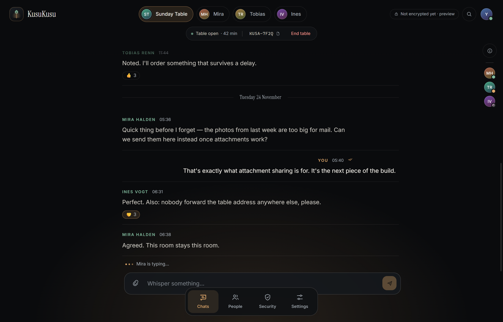
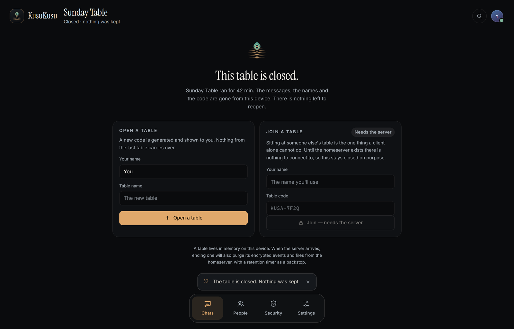
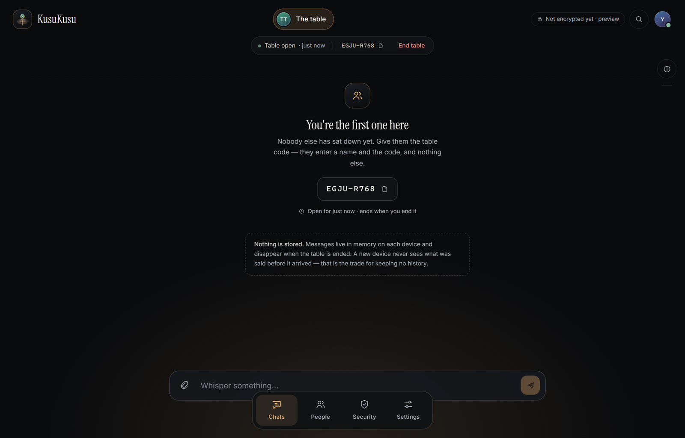
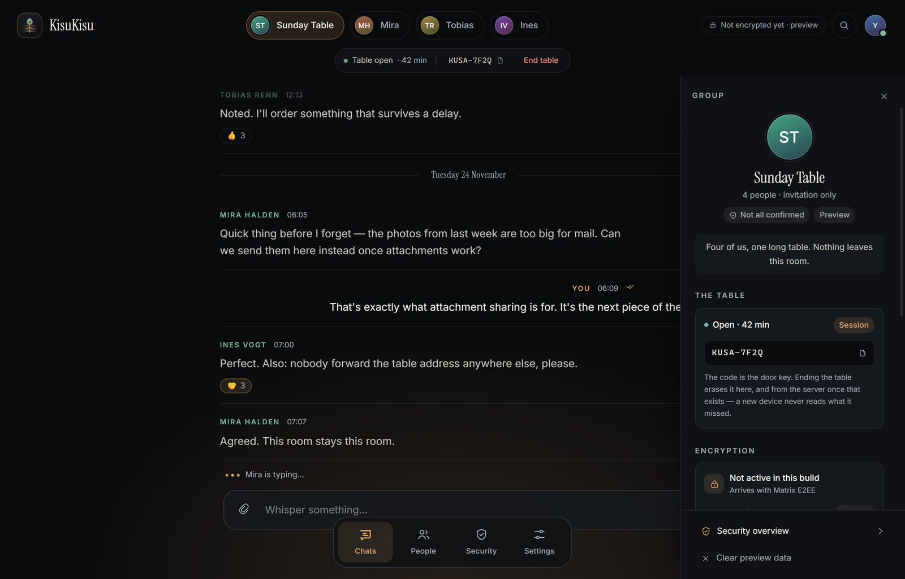
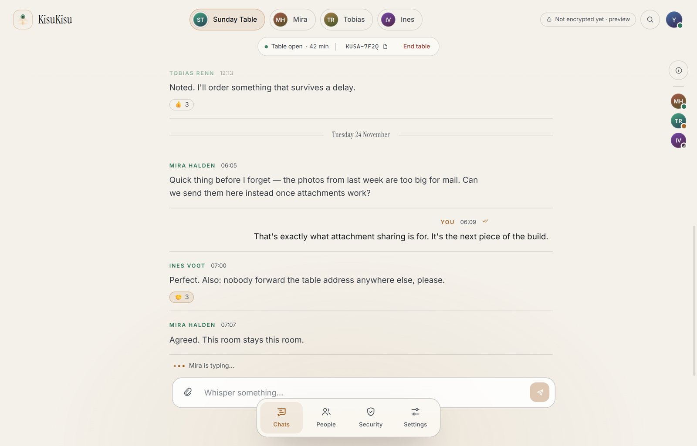

# KusuKusu

**A private table for a few people.** Not another messenger.

KusuKusu — குசு குசு, the Tamil sound of whispering — is a small desktop application for
end-to-end encrypted conversation between people who already know each other. There are no
accounts to create. You sit down at a table, and when the table is cleared, the conversation
is gone.

> **Status: Phase 1 of 7 — the interface exists, the encryption does not yet.**
> The app runs entirely on your device with sample data. It has no network connection and no
> cryptography, and it says so on screen rather than implying otherwise. What is and is not
> true today is recorded in [docs/security.md](docs/security.md) — that file is the honest one,
> not this page.

---

## The idea

Every messenger you already use is an archive with a chat window attached. History accumulates
by default, an account identifies you forever, and the company running it can see who talks to
whom. For a family group or four friends, most of that is unnecessary.

KusuKusu starts from the opposite assumption: **a conversation is an event, not a record.**

A **table** is opened by one person. Everyone else joins with a name and a short code —
`KUSA-7F2Q` — the way you'd tell someone which table you're sitting at. When the host ends it,
the messages stop existing: erased from each device, and purged from the server. No history to
scroll, no archive to leak, nothing to hand over later.

There is a cost, and the app states it plainly rather than hiding it:

- no offline catch-up once a table has ended;
- a new device can never read what was said before it arrived;
- screenshots and copies are beyond anyone's reach.

That trade is the whole point. If you want a permanent record, a conventional messenger does
that better.

## What it looks like

| A table that has just been ended | A table with nobody in it yet |
|---|---|
|  |  |

| Details drawer | The same screen on paper |
|---|---|
|  |  |

Rooms are tabs across the top, the conversation is text on the page rather than bubbles, and
navigation lives in a dock at the bottom. The thread gets the whole window because the
conversation is the product — see [docs/decisions.md](docs/decisions.md) for the three layouts
that were considered.

## Principles

1. **No invented cryptography.** Established, maintained implementations only — Matrix's
   end-to-end encryption through a maintained SDK, never a hand-rolled protocol.
2. **No security claim without a test.** The words "encrypted" and "secure" are earned by
   exercising the flow on two real devices, not by compiling.
3. **Nothing stored means nothing to leak.** A session ends and the server's copy is purged,
   with a retention timer as the backstop for a host who vanishes.
4. **Names are labels; devices are identities.** A safety number proves who you're talking to.
   A display name proves nothing, and the interface says so.
5. **Self-hosted, federation off.** The server belongs to the people using it, not to a
   provider.

## Where it's going

| Phase | What it covers | State |
|---|---|---|
| 1 | Desktop foundation and original interface | **done** |
| 2 | Self-hosted homeserver, tables as sessions, join by name + code | not started |
| 3 | End-to-end encryption, device verification, recovery key | not started |
| 4 | Direct and group messaging, offline delivery, receipts | not started |
| 5 | Encrypted attachments | not started |
| 6 | Notifications, search, polish | not started |
| 7 | Tests, security review, Windows and Linux builds | not started |

Voice and video calls are deliberately out of scope: they widen the attack surface and the
metadata footprint far more than a few friends need.

Full detail in [docs/roadmap.md](docs/roadmap.md), architecture in
[docs/architecture.md](docs/architecture.md), the session model in
[docs/sessions.md](docs/sessions.md).

## Questions people actually ask

**Is it encrypted right now?**
No. There is no cryptography in this build. The interface says "Not encrypted yet" on the main
screen, and the Security page lists what is implemented and what is not.

**Why not just use Signal?**
Signal is excellent, and if you want one app for everything with a permanent history, use it.
KusuKusu is for the different shape: a temporary table, no account, no archive, and a server
your group owns.

**Do I need an account or a phone number?**
No. A name and a table code. Names are unique at a table while it's live, bound to the device
that claimed them, and released when it ends.

**Where do messages live?**
On the server only while the table is open, encrypted so the server can't read them. Ending the
table purges them. Nothing is written to disk on the client.

**Why Matrix?**
Because the alternative is designing an encrypted protocol ourselves, and that is how projects
end up with home-made encryption nobody can review. Matrix has a maintained E2EE stack and a
server (Synapse) that can be self-hosted.

**Is the source available?**
The application source is private while the project is unfinished. This repository documents the
design, the security state and the plan, so the decisions can be reviewed before there is
anything to run.

## What this repository is

Documentation only: the design rationale, the session model, the security state, the roadmap,
and screenshots of the current build. It is the public face of a private project — no source
code, no binaries, no configuration.

## Name

**KusuKusu** (குசு குசு) is the Tamil word for the sound of something said quietly, close by.
It is also, in a schoolyard sense, a slightly rude word — which the friends it was built for
find funny.

---

© The KusuKusu project. Documentation shared for reading; no licence is granted for the
application itself.
