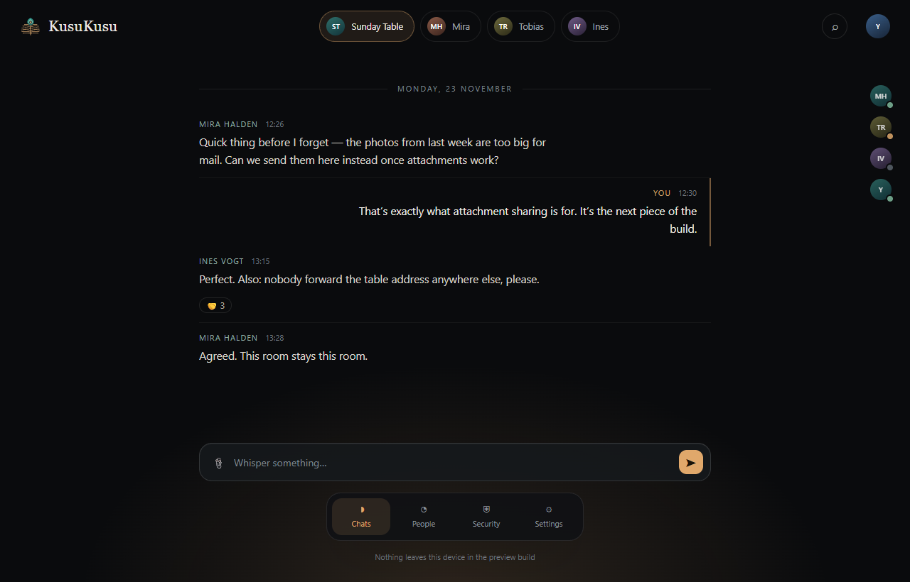
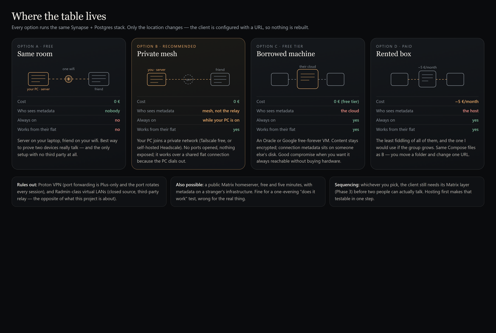

# Decisions

Why the project looks the way it does. Recorded so the reasoning can be revisited instead of
re-derived.

## The interface is not a sidebar with bubbles

A first draft used the familiar shape — icon rail, conversation list, rounded message bubbles —
and it looked like every other messenger, which is a problem when the product is meant to feel
like a private room rather than a corporate inbox.

Three layouts were mocked and compared:

**Rooms as tabs, a borderless thread, a dock at the bottom** (pictured) won because:

- the conversation gets the whole window, which matters when reading is the only activity;
- a small circle of people maps naturally onto a few tabs — a list column is for hundreds of
  conversations, which this is not;
- text with a name and time above it reads as conversation rather than as message balloons;
- bottom navigation lifts the app away from the left-rail dashboard look shared by most desktop
  chat tools.

The alternatives were an editorial "letter" layout (beautiful, but slow for long threads and
unfamiliar for a non-technical user) and a people-first layout with a large identity column
(excellent for verification states, but it spends a third of a 1280 px window on identity).

## Tables are sessions, not rooms

Matrix persists events by design. "Nothing is stored" is therefore a lifecycle the project
implements on top of the protocol, never a configuration flag. A table is created, lived in, and
purged; retention is the backstop. The full model, including what deletion can and cannot mean,
is in [sessions.md](sessions.md).

## No accounts

Accounts are plumbing. For a handful of friends, an email address, a password and a recovery
flow add three things that can leak and nothing that helps. Entry is a name plus a short table
code: the code is the door key, the encryption is the lock, and the app says which is which.
Names are unique at a table while it is live and bound to the device that claimed them.

## Where the server lives

All four options run the same Compose stack; only the address the client points at changes.
Nothing on this list requires rebuilding the app.

**Ruled out:**

- **VPN-provider port forwarding** — the paid tier assigns a dynamic port that changes every
  session, so a stable server address is impossible.
- **Closed-source virtual LAN tools** — convenient, but they relay through an opaque third party,
  which is the opposite of the project's premise.
- **Public tunnel services** — free and fast to try, but they terminate TLS at the provider, so
  they see exactly what the project exists to keep private.

## Deliberately out of scope

Voice and video (attack surface and metadata), federation (metadata shared between servers),
public registration (tables are joined by code), and a custom protocol (the one shortcut this
project will not take — established implementations only).
